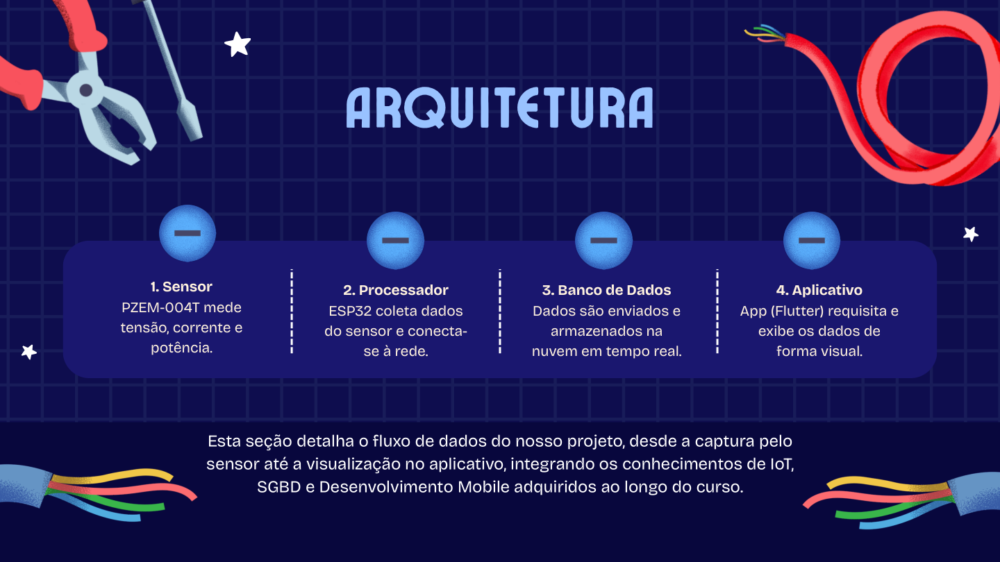
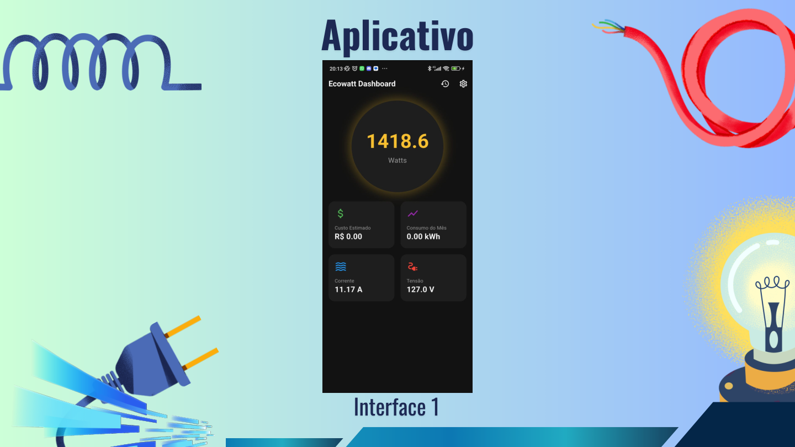
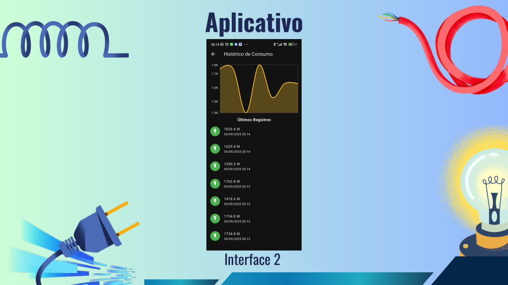
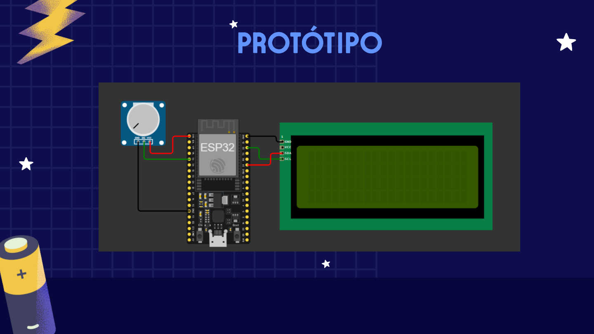

<p align="center">
  
</p>

# EcoWatt - Monitoramento de Consumo Energético

Sistema IoT com aplicativo móvel que monitora, em tempo real, o consumo de energia elétrica e envia os dados para o celular do usuário, ajudando a acompanhar os gastos e a consumir de forma mais consciente.

Projeto Integrador do curso técnico em **Redes de Computadores** do **IFSP - Campus Pirituba** (3º ano, 2025), premiado como **Melhor Projeto Integrador** no Cybergites (11/2025).

## Problema e objetivo

A produção de energia elétrica responde por uma parcela relevante das emissões de gases de efeito estufa, e muita gente não sabe quanto consome nem quanto isso custa. O objetivo do EcoWatt é **desenvolver um dispositivo que calcule o consumo de energia em residências, laboratórios ou empresas**, dando visibilidade ao consumo e incentivando a economia.

O projeto se alinha aos Objetivos de Desenvolvimento Sustentável **ODS 11** (Cidades e Comunidades Sustentáveis) e **ODS 12** (Consumo e Produção Responsáveis).

## Como funciona

1. **Sensor**: o projeto prevê o PZEM-004T para medir tensão, corrente e potência (na simulação, um potenciômetro faz esse papel).
2. **Processador**: o ESP32 coleta os dados do sensor e se conecta à rede Wi-Fi.
3. **Banco de dados**: os dados são enviados ao **Firebase Realtime Database**, na nuvem, em tempo real.
4. **Aplicativo**: o app em **Flutter** consulta o banco e exibe os dados de forma visual.



## Aplicativo

O app (Android) traz um painel com a potência atual, o custo estimado, o consumo do mês, a corrente e a tensão, e uma tela de histórico com gráfico e os últimos registros.

| Painel | Histórico de consumo |
|---|---|
|  |  |

## Protótipo

O firmware foi desenvolvido e testado em um protótipo virtual no **Wokwi**: um ESP32, um potenciômetro que simula o sensor de corrente e um display LCD 20x4 (I2C) que mostra potência, corrente e tensão. O dispositivo físico não chegou a ser montado; o foco do projeto foi a simulação, a integração com o Firebase e o aplicativo.



### O que o firmware faz

- Lê o valor analógico do sensor (pino 34) e converte para corrente (0 a 15 A na simulação).
- Calcula a potência (tensão fixa de 127 V × corrente) e a energia acumulada em kWh.
- Exibe os valores no LCD e envia, a cada **1 segundo**, as leituras ao nó `leituras` do Firebase.
- A cada **5 minutos**, registra a potência no nó `historico`, com o carimbo de data e hora do servidor.

## Tecnologias

| Camada | Tecnologia |
|---|---|
| Microcontrolador | ESP32 (C++ / framework Arduino) |
| Sensor | PZEM-004T previsto (tensão, corrente e potência); potenciômetro na simulação |
| Comunicação | Wi-Fi, HTTP (REST) e JSON com ArduinoJson |
| Banco de dados | Firebase Realtime Database |
| Aplicativo | Flutter (Android) |
| Simulação | Wokwi |

## Estrutura do repositório

```
firmware/ecowatt_esp32/   Código do ESP32 (Arduino / C++)
docs/                     Imagens do projeto (app, protótipo, arquitetura)
```

## Como executar o firmware

1. Abra `firmware/ecowatt_esp32/ecowatt_esp32.ino` no [Wokwi](https://wokwi.com) (projeto ESP32) ou na Arduino IDE.
2. Instale as bibliotecas **ArduinoJson** e **LiquidCrystal_I2C**.
3. Crie um projeto no Firebase com o Realtime Database e preencha, **apenas localmente**, `FIREBASE_HOST` e `FIREBASE_AUTH` no início do arquivo.
4. Não envie credenciais para o Git. Configure as regras do banco para restringir o acesso.

## Ideias futuras

- Controle ON/OFF de cargas
- Integração com aparelhos inteligentes
- Alertas inteligentes de consumo
- Gamificação para incentivar a economia

## Equipe

Projeto desenvolvido por Kayky, Nicolas, Raphael e Samuel, alunos de Redes de Computadores do IFSP - Campus Pirituba.

**Kayky Cayres Vicente da Silva**: concepção da ideia, programação e design.
[LinkedIn](https://www.linkedin.com/in/kayky-cayres-vicente-da-silva-3b540a335/) · [GitHub](https://github.com/KaykyCayres)
